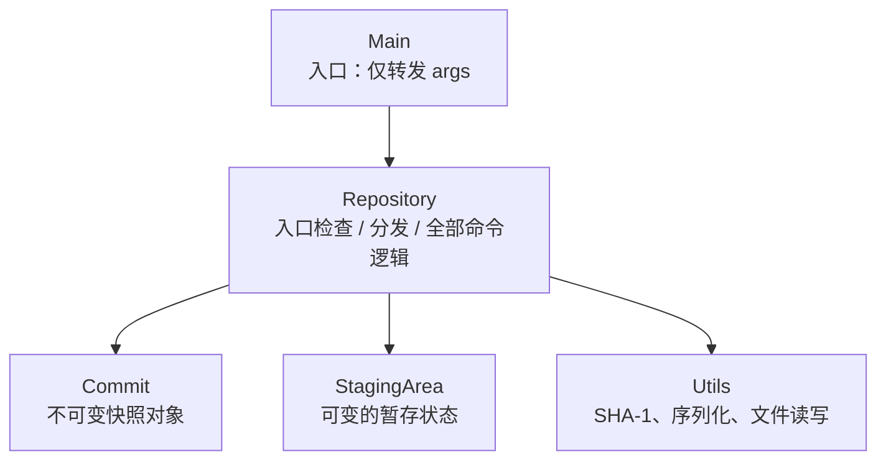

# Gitlet

> 用 Java 从零实现的轻量版本控制系统 —— UC Berkeley CS61B Project 2

[](https://openjdk.org/)
[](#测试)
[](#命令参考)

[English](README.en.md) | 简体中文

Gitlet 是 Git 的一个子集：内容寻址（content-addressable）存储、不可变提交
快照、分支、三路合并与远程仓库同步。全部内部状态持久化在 `.gitlet` 目录中，
相同内容的对象在全库只存一份。

- 仓库地址：<https://github.com/Seeleelysiahua/gitlet>
- 课程项目：UC Berkeley CS61B, Project 2 (Gitlet)
- 开发方式：先完成覆盖对象模型、磁盘布局、错误处理与 18 个命令的设计文档，
  再按设计逐命令实现并配套集成测试
- 设计文档：见 [`docs/design/`](docs/design/README.md)（6 篇共享设计 + 18 张命令卡）

> 仅用于自学记录，请勿抄袭。

## 目录

- [特性](#特性)
- [快速开始](#快速开始)
- [命令参考](#命令参考)
- [设计与实现](#设计与实现)
- [测试](#测试)
- [项目结构](#项目结构)
- [开发过程](#开发过程)
- [说明与限制](#说明与限制)
- [致谢](#致谢)

## 特性

- **完整的本地工作流**：`init` / `add` / `commit` / `rm` / `log` /
  `global-log` / `find` / `status` / `checkout` / `branch` / `rm-branch` /
  `reset` / `merge`，共 13 个本地命令
- **远程仓库**：`add-remote` / `rm-remote` / `fetch` / `push` / `pull`，
  基于文件系统路径在两个 `.gitlet` 目录之间同步对象与分支指针
- **内容寻址存储**：blob 与 commit 均以 SHA-1 命名，内容相同则对象相同
- **不可变快照**：commit 保存完整文件快照而非差异，构造后不可修改；
  `objects/` 中的对象只增、不改、不删
- **三路合并**：以最深的公共祖先为 split point，支持快进、祖先短路、
  自动合并提交与冲突标记
- **缩写 commit ID**：`checkout` 与 `reset` 接受十六进制前缀，缩写歧义或
  不存在时安全报错
- **失败原子性**：写命令统一遵循“检查 → 内存计算 → 落盘”，任何业务失败
  都发生在首次写盘之前，工作目录与 `.gitlet` 保持不变
- **逐字一致的错误输出**：全程序只有一个错误打印出口，消息与设计文档
  逐字对齐

## 快速开始

### 环境要求

| 依赖 | 版本 | 用途 |
| --- | --- | --- |
| JDK | 14+（本仓库在 26.0.1 上验证） | 编译与运行 |
| Python | 3（实测 3.9.6） | 运行集成测试 |
| GNU Make | 任意 | 构建与测试入口 |

### 获取与构建

```sh
git clone https://github.com/Seeleelysiahua/gitlet.git
cd gitlet
make            # 编译 gitlet 包，开启 -Xlint:unchecked -Xlint:deprecation
```

编译产物（`gitlet/*.class`、`gitlet/sentinel`）生成在 `gitlet/` 目录，已被
`.gitignore` 忽略。`make clean` 可清除这些产物。

### 运行

类位于 `gitlet` 包中，JVM 需要把**仓库根目录**作为 classpath 根。推荐在
任意实验目录里用 `-cp` 指向仓库：

```sh
mkdir -p ~/playground/gitlet-demo && cd ~/playground/gitlet-demo
java -cp /absolute/path/to/gitlet gitlet.Main init
```

或者设置一个别名，后续直接使用 `gitlet`：

```sh
alias gitlet='java -cp /absolute/path/to/gitlet gitlet.Main'
gitlet init
```

> 注意两点：
> 1. 不要先 `cd gitlet` 再执行 `java gitlet.Main`，此时 classpath 根是
>    `gitlet/`，会报 *找不到或无法加载主类 gitlet.Main*；
> 2. 不要在仓库根目录执行 `init`，否则 `.gitlet` 会混进源码树。

### 一个最小会话

```console
$ gitlet init
$ echo "hello wug" > wug.txt
$ gitlet add wug.txt
$ gitlet commit "add wug"
$ gitlet branch dev
$ gitlet checkout dev
$ echo "dev only" > dev.txt
$ gitlet add dev.txt
$ gitlet commit "dev work"
$ gitlet checkout master
$ echo "master only" > master.txt
$ gitlet add master.txt
$ gitlet commit "master work"
$ gitlet merge dev
$ gitlet log
===
commit 4e3da568b73b76cdb0a231de6241222979b3468d
Merge: e401dbc 7369b74
Date: Thu Oct 29 09:50:50 2026 +0800
Merged dev into master.

===
commit e401dbc98c532c589024ee07c7ad673db4bb1849
Date: Thu Oct 29 09:50:50 2026 +0800
master work
...
```

> 输出中的 commit ID 与时间随每次运行变化，此处格式与真实输出一致。

## 命令参考

### 本地命令（13 个）

| 命令 | 用法 | 行为 |
| --- | --- | --- |
| `init` | `init` | 在当前目录创建 `.gitlet`，建立 initial commit、`master` 分支与空暂存区 |
| `add` | `add <file>` | 暂存文件当前版本；若内容与当前提交相同则取消暂存 |
| `commit` | `commit <message>` | 把暂存区提交为新快照，并前移当前分支指针 |
| `rm` | `rm <file>` | 取消暂存；若文件被当前提交追踪，同时标记删除并删除工作文件 |
| `log` | `log` | 沿 first parent 打印当前分支历史 |
| `global-log` | `global-log` | 打印全库所有 commit，不限于当前分支 |
| `find` | `find <message>` | 按提交信息精确查找，每行打印一个匹配的完整 commit ID |
| `status` | `status` | 五节版式：分支、已暂存、已移除、未暂存修改、未追踪文件 |
| `checkout` | `checkout -- <file>` | 用当前提交中的版本覆盖工作文件 |
|  | `checkout <id> -- <file>` | 用指定提交（可用缩写 ID）中的版本覆盖工作文件 |
|  | `checkout <branch>` | 切换分支：替换工作目录、移动 HEAD、清空暂存区 |
| `branch` | `branch <name>` | 新建分支指针，指向当前 commit |
| `rm-branch` | `rm-branch <name>` | 删除分支指针，不删除任何 commit |
| `reset` | `reset <id>` | 把当前分支与工作目录回退到指定 commit（可用缩写 ID） |
| `merge` | `merge <branch>` | 三路合并；无冲突时自动提交 `Merged <branch> into <current>.`，有冲突时写入冲突标记并报告 |

### 远程命令（5 个）

远程名通过路径关联到另一个本地 `.gitlet` 目录，不涉及网络协议。

| 命令 | 用法 | 行为 |
| --- | --- | --- |
| `add-remote` | `add-remote <name> <path>` | 关联远程名与远程 `.gitlet` 目录路径 |
| `rm-remote` | `rm-remote <name>` | 删除远程关联 |
| `fetch` | `fetch <name> <branch>` | 复制本地缺失的 commit/blob，并更新 `refs/remotes/<name>/<branch>` |
| `push` | `push <name> <branch>` | 快进检查通过后，向远程复制对象并更新远程分支指针（远程无此分支时新建） |
| `pull` | `pull <name> <branch>` | 等价于 `fetch <name> <branch>` 后 `merge <name>/<branch>` |

所有失败都经由统一出口打印逐字错误消息，随后以退出码 0 结束；正常命令
成功时不产生多余输出。

## 设计与实现

完整设计文档收录在 [`docs/design/`](docs/design/README.md)：6 篇共享设计
（对象模型、持久化、错误处理、测试策略等）、18 张命令卡、关键决策登记与
对象接口清单。下面只摘录实现的骨架与关键机制。

### 类结构



依赖严格自上而下，无循环依赖。`Main` 极薄；入口检查管线（空输入 → 未知
命令 → 操作数数量 → 是否已初始化）与命令分发集中在 `Repository.run`。

### `.gitlet` 目录布局

```
.gitlet/
├── objects/
│   ├── commits/          # commit 对象（Java 序列化），文件名为 40 位 ID
│   └── blobs/            # blob 原始字节，文件名为 40 位 ID
├── refs/
│   ├── heads/            # 本地分支：分支名 → commit ID（单行文本）
│   └── remotes/<name>/   # 远程跟踪分支：分支名 → commit ID
├── HEAD                  # 当前分支名（HEAD 只引用分支，不直接指向 commit）
├── stage                 # 暂存区（序列化：addition 映射 + removal 集合）
└── remotes               # 远程映射（序列化 HashMap：远程名 → 远程 .gitlet 路径）
```

### 关键机制

- **提交 ID**：把消息、时间戳、父提交 ID 与映射对按固定顺序交给 SHA-1，
  映射对先按文件名排序，因此文件的插入顺序不影响 ID；blob ID 直接对文件
  字节做 SHA-1。blob 与 commit 分目录存储，哈希空间互不干扰。
- **落盘定序**：先写只增的新对象（此时无任何引用，对外不可见） → 再移动
  分支指针（版本切换的唯一一步） → 最后清空暂存区。任何会抛异常的检查
  都必须在第一次写盘之前完成。
- **统一汇报链**：所有失败 `throw Utils.error(...)`，传播到 `run` 中唯一的
  `catch`，打印消息后退出；`Utils.message` 是唯一的正常输出通道。
- **merge 决策表**：以“blob ID 相同即内容相同”为判断基础，只需比较
  split point、当前提交、给定提交三方的 blob ID，即可覆盖新增 / 修改 /
  删除 / 双方同改 / 冲突等情形；split point 取深度最大的公共祖先。
- **复用边界**：同一段逻辑第二次出现才提取 helper，如 `makeCommit`
  （commit 与 merge 共用）、`replaceWorkingDir`（checkout 与 reset 共用）、
  `copyMissingObjects`（fetch 与 push 方向互反共用）。

## 测试

测试基于课程提供的 `testing/tester.py`：每个 `.in` 用例在临时目录中执行
真实的 `java gitlet.Main` 命令序列，逐字（或用 `definitions.inc` 中的正则
替换易变输出）比对标准输出与文件系统状态。

```sh
make check     # 编译并运行全部集成测试
```

实测结果（macOS + JDK 26.0.1 + Python 3.9.6）：

```
Ran 54 tests. All passed.
```

`make clean && make` 编译零 warning，随后 `make check` 全量通过。

- **4 个官方样例**：`testing/samples/test01–04`
- **50 个自有用例**：`testing/student_tests/test10–59`

| 命令 | 用例 | 命令 | 用例 |
| --- | --- | --- | --- |
| `init` | test10 | `reset` | test19 |
| `add` | test11 | `status` | test20–21 |
| `commit` | test12 | `merge` | test22–35 |
| `log` | test13 | `add-remote` / `rm-remote` | test36–39 |
| `global-log` | test14 | `fetch` | test40–45 |
| `find` | test15 | `push` | test46–53 |
| `rm` | test16 | `pull` | test54–59 |
| `branch` / `rm-branch` | test17 | `checkout` | test18 |

自有用例覆盖每个命令的正常路径、每条失败消息的逐字输出、失败后状态不变，
以及远程多仓库场景（`push` 非快进拒绝、失败原子性、`pull` 冲突等）。期望
输出均为参照规范手写，不由程序自身输出生成。

单独运行某个用例：

```sh
cd testing
python3 tester.py --verbose student_tests/test32-merge-conflict-both.in
```

`--keep` 可保留临时目录以检查内部状态，`--tolerance=0` 可关闭输出容差。
运行前需先 `make` 生成 `gitlet/Main.class`。

## 项目结构

```
.
├── Makefile              # 顶层入口：make / make check / make clean
├── pom.xml               # 课程 Maven 配置（依赖课程本地父 POM，见“说明与限制”）
├── README.md
├── README.en.md          # 英文版 README
├── docs/design/          # 设计文档：共享设计、命令卡、决策登记、接口清单
├── gitlet/
│   ├── Makefile          # 编译 .java 到本目录并生成 sentinel
│   ├── Main.java         # 入口，仅调用 Repository.run
│   ├── Repository.java   # 入口管线、18 个命令与辅助方法（约 1200 行）
│   ├── Commit.java       # 不可变提交对象（五字段，不自算 ID）
│   ├── StagingArea.java  # 暂存区（TreeMap addition + TreeSet removal）
│   ├── Utils.java        # 课程工具类：SHA-1、序列化、文件读写
│   ├── GitletException.java
│   └── Dumpable.java / DumpObj.java   # 课程提供的对象调试工具
└── testing/
    ├── Makefile
    ├── tester.py         # 集成测试驱动器
    ├── runner.py         # 课程测试运行器
    ├── staff-runner.py   # 课程评分脚本
    ├── samples/          # test01–04 官方样例
    ├── student_tests/    # test10–59 自有用例
    └── src/              # 测试引用的素材文件
```

## 开发过程

- 先搭数据类（`Commit`、`StagingArea`）与入口管线骨架，再按依赖顺序逐命令
  实现：`init` → `add` → `commit` → 历史查询 → `rm` → 分支 → `checkout` →
  `reset` → `status` → `merge` → 远程命令
- 每个命令（或每对强相关命令，如 `branch`/`rm-branch`）与其测试用例
  同一次提交，提交信息采用 Conventional Commits 前缀

## 说明与限制

- **`pom.xml` 不可独立使用**：它继承了课程环境中的 `library-sp21` 父 POM，
  脱离该环境无法解析；构建与测试一律以 `Makefile` 为准。
- **设计文档**：[`docs/design/`](docs/design/README.md) 收录 6 篇共享设计、
  18 张命令卡、关键决策登记与对象接口清单；课程原始 spec 与需求整理因版权
  原因未收录，文中 `spec` 指课程需求文档。
- **远程仅限本地路径**：`add-remote` 记录的是本机文件系统路径，不实现
  SSH/HTTP 协议，也不做并发与权限控制。
- **课程学术规范**：本项目为自学作品，仅用于自学记录，请勿抄袭；请遵守所在课程的学术诚信政策，不要直接提交他人代码。


## 致谢

- 课程与官方骨架、测试框架：UC Berkeley CS61B（Josh Hug 及课程组）。
  `gitlet/` 中的 `Utils.java`、`GitletException.java`、`Dumpable.java`、
  `DumpObj.java` 以及 `testing/` 下的 `tester.py`、`runner.py`、
  `staff-runner.py` 均来自课程提供的骨架。
- 设计文档与命令实现以本人为主完成；文档整理与评审环节有 AI 工具参与。
