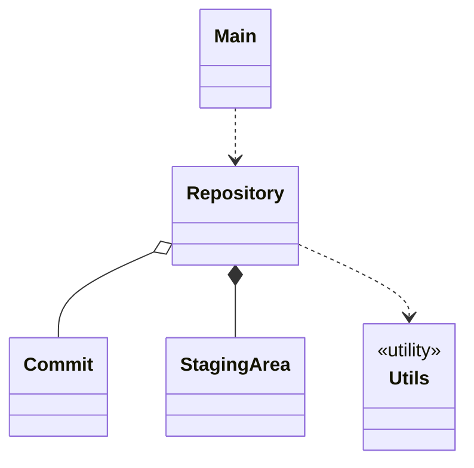

# 01 Overall Architecture

## 1. Class Overview



Utils is a utility class. Repository uses it for file I/O and hashing. Commit and StagingArea are pure data classes and do not directly depend on Utils.

## 2. Class Responsibilities

| Class | Responsibility | Not responsible for |
| --- | --- | --- |
| Main | Receive args and pass them to Repository | Implementing commands; parsing arg contents |
| Repository | Entry checks; dispatch by command name; implement local and remote command logic; read/write objects and repo state in `.gitlet` | Defining Commit fields |
| Commit | Record one commit's metadata and file snapshot map | Holding file bytes; maintaining staging area, branch pointers, and HEAD |
| StagingArea | Hold two groups of staged entries: addition and removal (staging rules are executed by Repository) | Reading/writing working directory and file contents; maintaining branches; turning staged entries into a commit; executing staging rules |

## 3. Dependencies

Dependency direction is strictly top-down: **Main → Repository → data layer (Commit and StagingArea)**. Reverse dependencies and cycles are forbidden.

```text
Entry layer        Main
                    │
Coordinator        Repository
                    │
Data layer         Commit  StagingArea
```

- Main only calls the main entry method of Repository. It does not directly access the data layer.
- Repository can create, read, and persist Commit and StagingArea objects.
- Commit and StagingArea do not depend on each other. If one needs the other's data, Repository gets it and passes it in.
- Commit and StagingArea must not depend on Main or Repository.
- Repository depends on Utils. Commit and StagingArea are pure data classes and do not directly depend on Utils. Utils does not depend on any business class.

## 4. Command Flow

1. `Main.main` calls `Repository.run(args)`.
2. Inside `run`, the order is: entry checks → dispatch → execute.
   - **Entry checks**: four checks in fixed spec order (empty input → unknown command → wrong operands → not initialized). If any fails, immediately throw `Utils.error(...)` and use the unified reporting chain. `init` skips the not-initialized check. Details in [04 Error Handling](04-error-handling.md).
   - **Dispatch**: `switch` on `args[0]`, route to the corresponding command method.
   - **Execute**: call the command method and pass only operands (not the command name).
- Command method names are the same as command names, all lowercase.
- Hyphenated names become camelCase: `global-log` → `globalLog`, `rm-branch` → `rmBranch`, `add-remote` → `addRemote`, `rm-remote` → `rmRemote`.
- Methods receive only operands. `init` is called with no arguments.
