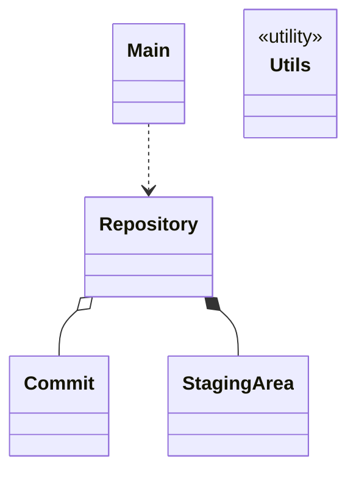
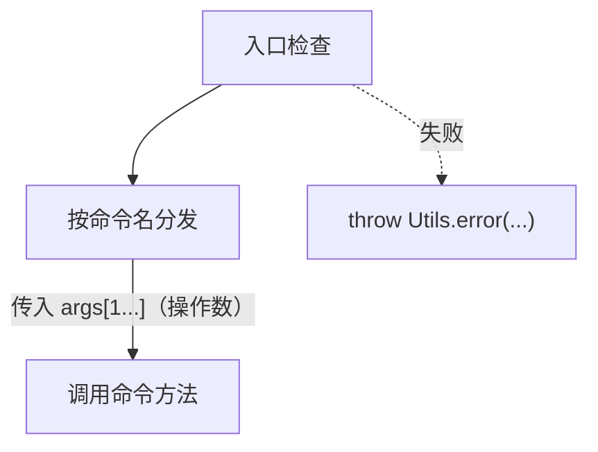

# 01 总体架构

## 1. 类全景图




Utils 为工具类，Repository 通过它完成文件读写与哈希；Commit 与 StagingArea 是纯数据类，不直接依赖 Utils

## 2. 各类职责

| 类           | 职责                                                  | 不负责                              |
| ----------- | --------------------------------------------------- | -------------------------------- |
| Main        | 接收参数并转交给 Repository                                 | 实现命令；解析参数内容                      |
| Repository  | 执行入口检查；按命令名分发；实现本地与远程命令的业务逻辑；读写 `.gitlet` 中的对象与仓库状态 | 定义 Commit 的字段结构                  |
| Commit      | 记录一次提交的元数据与文件快照映射                                   | 持有文件字节；维护暂存区、分支指针与 HEAD          |
| StagingArea | 保管 addition 与 removal 两组暂存条目（暂存规则由 Repository 执行）                 | 读写工作目录与文件内容；维护分支；将暂存条目提交为 commit；执行暂存规则 |

## 3. 依赖关系

依赖方向严格自上而下：Main → Repository → 数据层（Commit 和 StagingArea），禁止反向依赖与环形依赖。

```
入口层         Main
               │
协调层      Repository
               │
数据层    Commit StagingArea

```

- Main 只调用 Repository 的总入口方法，不直接访问数据层。
- Repository 可创建、读取并持久化 Commit 和 StagingArea 对象。
- Commit 和 StagingArea 互不依赖；任何一方需要另一方的数据时，由 Repository 取出后传入。
- Commit 和 StagingArea 不能反向依赖 Main 和 Repository。
- Repository 依赖 Utils；Commit、StagingArea 为纯数据类，不直接依赖 Utils。Utils 不反向依赖任何业务类。

## 4. 命令处理流程

Main.main 调用 Repository.run(args)。

run 内部依次完成：入口检查 → 分发 → 执行：

- 入口检查：四项，按 spec 固定顺序（空输入 → 未知命令 → 参数错 → 未初始化），任一失败立即 `throw Utils.error(...)`（统一汇报链）；`init` 豁免未初始化检查。细节写见 [04 错误处理](04-error-handling.md)。
- 分发：switch 读 `args[0]`，路由到对应命令方法。
- 执行：调用命令方法，只传入操作数（不含命令名）。





- 命令方法名与命令同名、全小写；
- 带连字符者转驼峰：global-log → `globalLog`、rm-branch → `rmBranch`、add-remote → `addRemote`、rm-remote → `rmRemote`；
- 参数统一只传操作数，`init` 无参调用。
